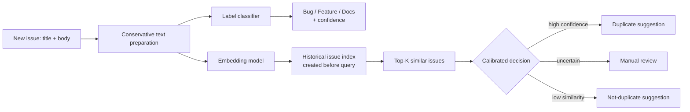

# GitHub Issue Auto-Labeler & Duplicate Finder

## Milestones 1–2 project handbook and presentation guide

> **Superseded for official milestone submission.** This document follows the original project
> plan’s internal naming (problem definition as M1 and data preparation as M2). The supplied course
> PDF instead defines M1 as a five-paper literature survey and M2 as baseline reproduction. Use
> `OFFICIAL_M1_M2_REPORT.pdf` as the primary submission; retain this handbook only as engineering
> groundwork and data-pipeline documentation.

**Prepared:** 28 October 2026  
**Project stage:** M1 complete as a defensible design; M2 pilot complete; full training corpus not yet frozen  
**Core rule:** do not call an issue a verified duplicate merely because two texts are similar.

---

## 1. The project in one minute

Popular open-source projects receive more issues than maintainers can immediately triage. A new
issue must be categorized, and a maintainer often has to search older reports to decide whether the
same problem already exists. Our proposed system supports that workflow with two related NLP tasks:

1. **Issue-type classification:** use only information available when an issue is submitted—mainly
   title and body—to predict one standardized class such as Bug, Feature, or Documentation.
2. **Duplicate retrieval:** embed the new issue, search only issues that already existed at that
   moment, return the top-K similar candidates, and make a duplicate / not-duplicate / manual-review
   recommendation using a calibrated threshold.

The system is decision support, not an autonomous closer. Low-confidence and high-impact cases go
to a maintainer.



### What the project does not do

- It does not use comments, closure decisions, or future metadata as model input.
- It does not treat every repository label as a class.
- It does not claim that nearest neighbors are duplicate ground truth.
- It does not close or label live issues during the M1/M2 demonstration.

---

## 2. Milestone 1 — problem definition and business case

### 2.1 Problem statement

Maintainers repeatedly perform two time-consuming actions: identify the intent/type of a new issue
and search historical issues for the same underlying problem. The project should reduce search and
triage effort while keeping the final decision explainable and reversible.

### 2.2 Users and value

| User | Current pain | Proposed value |
| --- | --- | --- |
| Maintainer/triager | Manual label selection and repeated searches | Suggested class and ranked historical candidates |
| Repository administrator | Inconsistent triage across people and time | Auditable taxonomy and confidence policy |
| Contributor | May report an already known problem | Earlier visibility of similar reports |
| Project lead | Cannot easily measure triage quality | Per-class, per-repository, retrieval, latency, and coverage metrics |

### 2.3 Input and output contract

**Inputs allowed at prediction time**

- Required: repository, issue title.
- Optional: issue body and non-decision metadata already present at creation time.
- Repository identity may be used for repository-specific calibration, but performance must also be
  reported without it and on held-out repositories.

**Forbidden model inputs**

- Maintainer comments, later edits, final labels, closure reason, canonical duplicate link,
  reactions accumulated after creation, and any other future information.

**Outputs**

- Class probabilities and one predicted standardized class.
- Top-K historical issue URLs with similarity scores.
- Duplicate, not-duplicate, or manual-review recommendation.
- Model/version, retrieval timestamp, and evidence needed to audit the suggestion.

### 2.4 Scope decision after the pilot

The original four-class proposal was Bug / Feature / Documentation / Question. The live 1,000-row
pilot produced **421 Bug, 67 Feature, 35 Documentation, and only 1 Question** among 524 eligible
issues. That is a data finding, not a model failure.

**Recommended M3 scope:** train the first cross-repository classifier on **Bug, Feature, and
Documentation**. Keep Question/Support as an experimental fourth class only if label-targeted full
collection finds enough verified examples. Another defensible option is to benchmark the Question
class separately on the balanced NLBSE'24 dataset rather than force it into our operational corpus.

Why: many projects redirect questions to Discussions, Stack Overflow, or support channels. The
Question class therefore represents repository policy as much as issue language.

### 2.5 Repository-selection criteria

A repository stays in the final corpus only if it is:

1. public and not archived;
2. actively receiving and triaging issues;
3. large enough for the required target classes;
4. using labels or Issue Types with descriptions that match our taxonomy;
5. rich enough in issue text for NLP;
6. auditable for duplicate evidence; and
7. not so templated that the template alone predicts the target.

### 2.6 Candidate repository panel and pilot coverage

The list is intentionally a **candidate panel**. The full label-frequency audit decides final
membership.

| Repository | Domain | Pilot eligible targets: Bug / Feature / Docs / Question | Initial decision |
| --- | --- | ---: | --- |
| `microsoft/vscode` | Desktop developer tooling | 8 / 11 / 0 / 0 | Keep; label-targeted history needed |
| `microsoft/TypeScript` | Compiler/language | 39 / 4 / 0 / 1 | Keep; excellent duplicate audit trail |
| `flutter/flutter` | UI framework | 6 / 0 / 0 / 0 | Hold; organization Issue Types are replacing some labels |
| `kubernetes/kubernetes` | Cloud infrastructure | 45 / 8 / 1 / 0 | Keep; clear `kind/*` taxonomy |
| `pandas-dev/pandas` | Data library | 56 / 6 / 11 / 0 | Keep |
| `scikit-learn/scikit-learn` | ML library | 34 / 9 / 12 / 0 | Keep |
| `huggingface/transformers` | NLP/ML library | 41 / 9 / 0 / 0 | Keep for domain relevance; audit docs coverage |
| `godotengine/godot` | Game engine | 69 / 4 / 2 / 0 | Keep; useful platform/error text |
| `rust-lang/rust` | Compiler/language | 57 / 6 / 4 / 0 | Keep; prefix taxonomy needs careful mapping |
| `ansible/ansible` | IT automation | 66 / 10 / 5 / 0 | Keep |

The counts are from 100 newest issues per repository. They cannot estimate historical class
prevalence because the Search API pilot is recent-only.

### 2.7 Success metrics and proposed targets

Targets remain provisional until baseline results are measured. They are goals, not achieved
scores.

| Component | Primary metric | Provisional target | Why |
| --- | --- | ---: | --- |
| Classification | Macro-F1 across core classes | ≥ 0.75 | Does not let the Bug majority hide poor minority performance |
| Classification | Per-class precision/recall/F1 | Report all | Shows exactly which class fails |
| Cross-repository | Mean repository Macro-F1 + held-out-repo F1 | No >10-point collapse from in-repo result | Tests portability |
| Duplicate retrieval | Recall@5 | ≥ 0.80 | Canonical issue should be visible in a short review list |
| Duplicate ranking | MRR@10 and nDCG@10 | Baseline-relative improvement | Rewards putting the correct issue near the top |
| Auto duplicate suggestion | Precision at high-confidence threshold | ≥ 0.90 | False duplicate suggestions are costly |
| Triage policy | Coverage at that precision | Report, do not hide | A 99% precise system that handles 1% of issues is not useful |
| Runtime | p95 end-to-end demo latency | ≤ 2 seconds | Keeps the suggestion interactive; must be measured on stated hardware |
| Reliability | Successful processing rate | ≥ 99% excluding upstream outages | Operational quality |

Accuracy and weighted-F1 remain supplementary. For a one-canonical-item retrieval task,
Precision@K is reported but is less interpretable than Recall@K and reciprocal rank.

### 2.8 Baselines required before advanced models

- Classification: majority class; TF-IDF word/character n-grams + logistic regression.
- Retrieval: title-only TF-IDF cosine and BM25/BM25F-style title+body retrieval.
- Semantic retrieval: pretrained Sentence-BERT-style embeddings + cosine similarity.
- Later comparison: fine-tuned encoder and hybrid lexical + semantic reranker.

This ordering makes improvement measurable. Research on duplicate bug reports has long treated the
task as information retrieval over structured title/description fields, while Sentence-BERT gives an
efficient semantic-search representation; neither should be accepted without an in-domain baseline.

### 2.9 Risks and mitigation

| Risk | Consequence | Mitigation / audit |
| --- | --- | --- |
| Repository-specific label names | Wrong targets | Preserve raw labels; version mappings; review label descriptions |
| Multi-label issues | Ambiguous class | Include only one standardized class; exclude cross-class conflicts |
| Severe class imbalance | Inflated accuracy | Label-targeted collection; Macro-F1; per-class results; no test resampling |
| Question class scarcity | Untrainable target | Three-class core; external benchmark or repository-local experiment |
| Issue Types replacing labels | Missing targets | Capture both REST `type` and labels; record target source |
| Pull requests returned by Issues API | Contaminated corpus | Exclude records containing `pull_request` |
| Duplicate label without canonical link | Invalid retrieval ground truth | Require GraphQL `duplicateOf` or audited maintainer relationship |
| Temporal leakage | Unrealistically high results | For each query, retrieve only issues created earlier; chronological tests |
| Template leakage | Predict repository form, not intent | Remove empty template prompts; template-aware ablation |
| Comments/closure leakage | Uses future decisions | Keep them outside model features; only ground-truth/audit tables may use them |
| PII or accidental secrets | Privacy/security exposure | Do not model author identity; restrict raw data; scan before publishing |
| API rate limits | Partial, silent collection | Authentication, pagination, manifests, checksums, explicit failures, resume/caching |
| Repository drift | Stale mapping/model | Record collection date; version taxonomy; monitor performance over time |

### 2.10 M1 completion checklist

- [x] Problem, users, inputs, outputs, and non-goals defined.
- [x] Two tasks separated but connected in one architecture.
- [x] Candidate repository panel and inclusion criteria documented.
- [x] Metrics, targets, baselines, and human-review policy proposed.
- [x] Feasibility and risk register completed.
- [x] Initial architecture and presentation narrative completed.

---

## 3. Milestone 2 — data understanding and preparation

### 3.1 Source-of-truth hierarchy

1. **GitHub REST Issues API — primary collection source.** It returns current issue title, body,
   labels, Issue Type, timestamps, state, and closure reason. Pull requests must be filtered because
   GitHub's Issues API also returns them.
2. **GitHub GraphQL API — primary duplicate-pair source.** The `Issue.duplicateOf` field identifies
   the original/canonical issue. `stateReason=DUPLICATE` verifies duplicate status.
3. **GitHub timeline/comments — audit fallback.** Use only explicit maintainer/member relationships;
   keep the evidence URL and do not silently parse arbitrary user comments as truth.
4. **GH Archive / BigQuery — event-history supplement.** Useful for reconstructing public events and
   historical snapshots, but not a replacement for current issue state or structured `duplicateOf`.
5. **Published datasets — benchmark only.** NLBSE'24 can sanity-check three-class classification;
   GitBugs can sanity-check duplicate retrieval. They should not replace provenance from our chosen
   repositories.

### 3.2 Cross-check performed on duplicate truth

Two live examples were inspected through both their GitHub page and API data:

- Flutter issue [#181034](https://github.com/flutter/flutter/issues/181034) is closed with the
  structured REST value `state_reason=duplicate`; a maintainer comment points to canonical issue
  [#150326](https://github.com/flutter/flutter/issues/150326), and the repository applies
  `r: duplicate`.
- TypeScript issue [#63645](https://github.com/microsoft/TypeScript/issues/63645) is visibly closed
  as duplicate and contains candidate references, but the plain REST timeline does not provide the
  same clean canonical structure in every event. This is why the pipeline resolves final pairs via
  GraphQL `duplicateOf`, not label text alone.

GitHub documents that its `duplicate` state reason is structured metadata, and GraphQL documents
`duplicateOf` as a reference to the original issue. This is substantially stronger than creating a
positive pair from text similarity.

### 3.3 Pilot data card

| Field | Value |
| --- | --- |
| Collection time | 28 Oct 2026, timestamps saved in UTC |
| Repositories | 10 public GitHub repositories |
| Method | Search API, `repo:OWNER/REPO is:issue`, newest created first |
| Rows | 1,000 (100 per repository) |
| Unique `(repository, issue_number)` keys | 1,000 |
| Exact duplicate keys | 0 |
| Missing bodies | 3 |
| Classification-eligible | 524 |
| Cross-class taxonomy conflicts | 3, excluded |
| Structured duplicate-status rows | 18 |
| Duplicate-label rows | 5 |
| Text length among eligible issues | median 350 words; p90 733; max 2,998 |
| Integrity | One SHA-256 per repository snapshot in `data/raw/pilot/collection_manifest.json` |

**Critical limitation:** this pilot validates the pipeline and reveals current schema/taxonomy
behavior. It is not representative training data, because only the latest 100 issues from each
repository were sampled.

### 3.4 Fields retained

| Group | Fields | Use |
| --- | --- | --- |
| Identity/audit | repository, issue ID/number, URL | Deduplication and traceability |
| Model input | title, cleaned title+body | Classification/retrieval |
| Target metadata | original labels, Issue Type, standardized class, target source | Auditable labels |
| Duplicate truth | state reason, duplicate label flag; later canonical pair | Status versus pair truth |
| Time | created, updated, closed, collected timestamps | Temporal split and drift |
| Quality | missing body, lengths, conflict flag | EDA and filtering |
| Operations | source endpoint, collection route, manifest, SHA-256 | Reproducibility |

Author login is intentionally not part of the model table. It adds privacy and memorization risk
without supporting the stated problem.

### 3.5 Taxonomy policy

Source labels are never overwritten. The prepared table contains both original labels and the
standard class.

| Standard class | Examples of audited source names |
| --- | --- |
| Bug | `bug`, `Bug`, `kind/bug`, `C-bug`, `type: bug`, Issue Type `Bug` |
| Feature | `feature-request`, `Suggestion`, `Enhancement`, `New Feature`, `kind/feature`, `C-enhancement`, Issue Type `Feature` |
| Documentation | `Docs`, `Documentation`, `kind/documentation`, `A-docs` |
| Question — experimental | `Question`, `*question`, `kind/support`, `C-question` |

Rules:

1. mapping is case-insensitive but repository-aware;
2. several source labels may map to the same class;
3. labels mapping to multiple target classes make an issue ineligible;
4. an Issue Type and labels may jointly support one class;
5. a disagreement between Issue Type and labels is excluded and audited;
6. taxonomy version and review status are stored in configuration.

### 3.6 Text-preparation policy

The current cleaner is conservative:

- normalizes line endings and whitespace;
- removes hidden HTML comments and ordinary HTML tags;
- replaces URLs and user mentions with `<URL>` and `<USER>`;
- keeps visible Markdown link text;
- keeps code-block contents between `<CODE_BLOCK>` markers;
- retains filenames, stack traces, error messages, versions, and technical tokens;
- treats a missing body as an empty body while preserving the missingness flag.

Aggressive stemming, stop-word removal, and punctuation deletion are intentionally deferred. They
can destroy identifiers and error signatures that are unusually valuable in software issues.

### 3.7 Final collection plan

Run two collections and keep them separate:

1. **Unbiased chronological corpus:** a documented date window or full pagination per repository.
2. **Label-targeted enrichment:** collect configured labels separately, cap rows per
   repository/class, then deduplicate. Use this to ensure minority-class training coverage, never to
   estimate real-world prevalence.

Recommended freeze criteria:

- at least 500 usable examples per core class overall;
- at least 3 repositories contributing to every core class;
- no one repository supplies more than 40% of a class;
- at least 200 structured/audited duplicate pairs for a meaningful retrieval test, otherwise frame
  duplicate work as a pilot and use a published benchmark for the formal comparison;
- every raw file has collection time, query, API version, row count, and checksum.

### 3.8 Splitting and leakage prevention

**Classification**

- Provisional pilot: global chronological 70/15/15.
- Final report: chronological train/validation/test plus a repository-held-out evaluation.
- Fit TF-IDF vocabulary, scalers, class weights, thresholds, and all learned preprocessing on train
  only.
- Do not rebalance validation or test data.
- Near-identical issue templates/edits stay in one classification partition.

**Duplicate retrieval**

- A duplicate query is evaluated at its creation/closure time.
- Candidate index contains only issues created before the query.
- The canonical issue must already exist; otherwise the pair is not a valid retrieval case.
- The query issue itself, future issues, closure comments, `duplicateOf`, labels, and state reason are
  excluded from retrieval features.
- Random non-duplicate pairs are not enough: add hard negatives from same repository/component and
  close lexical neighbors that maintainers did not mark duplicate.

### 3.9 M2 completion status

- [x] Data card and source hierarchy documented.
- [x] Candidate repository list and two collection modes implemented.
- [x] Immutable pilot snapshots and checksum manifest saved.
- [x] Raw labels, Issue Types, and standardized taxonomy preserved.
- [x] Conservative text cleaner implemented and tested.
- [x] Pilot EDA and statistical summary generated.
- [x] Provisional chronological split generated.
- [x] Leakage and privacy policy documented.
- [x] Structured duplicate-pair GraphQL extractor implemented and tested.
- [ ] Full label-targeted/chronological collection run with an authenticated token.
- [ ] Final repository panel and three-versus-four-class decision frozen.
- [ ] Final duplicate pair count, hard-negative policy, and retrieval split frozen.

M2 is therefore **presentation-ready as a validated pilot**, not complete as a final modeling
dataset. That distinction is scientifically honest and should be said explicitly.

---

## 4. How to navigate and showcase the project tomorrow

### 4.1 Tabs/files to prepare before presenting

Open these in order:

1. This handbook.
2. Flutter [duplicate issue #181034](https://github.com/flutter/flutter/issues/181034).
3. `data/raw/pilot/collection_manifest.json`.
4. `outputs/M2_EDA_REPORT.md`.
5. `config/label_taxonomy.json`.
6. `data/processed/issues_clean.csv` (show only a few rows).
7. A terminal in the project root.

Do not depend on live API calls during the presentation. The saved snapshots, manifest, and report
are the evidence; the GitHub pages are only visual examples.

### 4.2 Recommended 8–10 minute script

**0:00–1:00 — problem and users**  
“Maintainers do two connected tasks: classify a new issue and search older issues for duplicates.
Our system assists both tasks and sends uncertain cases to manual review.”

**1:00–2:00 — architecture**  
Walk left-to-right through the diagram. Emphasize that both branches use only title/body at
prediction time.

**2:00–3:00 — authentic ground truth**  
Open Flutter #181034. Point to its text, duplicate status, and canonical issue #150326. Say:
“Similarity retrieves candidates; GitHub's structured duplicate relationship supplies truth.”

**3:00–4:00 — repository/data plan**  
Show the candidate table and explain why repository diversity matters. Then show the manifest:
collection time, query, row count, rate-limit status, and checksum.

**4:00–6:00 — M2 evidence**  
Show the EDA report. Lead with three findings: 1,000 unique rows; only 3 missing bodies; strong class
imbalance with only one Question example. Explain the evidence-driven three-class recommendation.

**6:00–7:00 — preparation and leakage**  
Show one raw row and the matching cleaned row. Point out that code/error text remains. Explain the
chronological split and “past-only” retrieval index.

**7:00–8:00 — reproducibility**  
Run tests and regenerate the report:

```bash
python3 scripts/verify_manifest.py data/raw/pilot/collection_manifest.json
python3 -m unittest discover -s tests -v
python3 scripts/prepare_dataset.py \
  --input data/raw/pilot \
  --taxonomy config/label_taxonomy.json \
  --output data/processed
python3 scripts/generate_eda.py \
  --data data/processed/issues_clean.csv \
  --quality data/processed/data_quality.json \
  --output outputs/M2_EDA_REPORT.md
```

**8:00–9:00 — status and next milestone**  
“M1 design and M2 pilot are ready. Next we run authenticated balanced/full collection, freeze the
taxonomy, then establish lexical baselines before training transformers.”

### 4.3 If asked to demonstrate “picking issues from repositories”

Show, do not mutate, the repository:

1. Go to a repository's **Issues** tab.
2. Open an issue and identify title, body, labels/Issue Type, creation time, and URL.
3. Explain that the collector obtains the same public fields through the API with pagination.
4. For a duplicate, show “closed as duplicate” and the canonical issue relationship.
5. Return to the local manifest and show that data was saved with provenance and checksum.

We do **not** need to create a new GitHub issue, install a bot, or label a live repository for M1/M2.
That belongs to integration/deployment milestones and would require repository authorization.

### 4.4 What to say if the internet fails

“The project does not rely on a live demo. These are immutable public-API snapshots; their queries,
timestamps, counts, and SHA-256 hashes are recorded. I can reproduce preparation and EDA locally.”

### 4.5 Claims to avoid

- Do not say the model is trained; it is not.
- Do not call the 1,000-row pilot representative.
- Do not say the four classes are finalized.
- Do not report the proposed targets as achieved results.
- Do not call a similar pair a confirmed duplicate.
- Do not hide the Question-class scarcity; it is one of the strongest M2 findings.

---

## 5. Likely questions and concise answers

**Why combine classification and duplicate retrieval?**  
They use the same new-issue text and serve the same triage moment, but they have different targets,
metrics, and models. Sharing preprocessing and the interface is efficient; evaluation remains
separate.

**Why not train directly on all GitHub labels?**  
Labels mix intent, component, priority, operating system, workflow state, and ownership. We map only
semantically compatible intent labels to an auditable taxonomy.

**Why multi-class rather than multi-label?**  
The first deliverable predicts one standardized issue intent. Original GitHub labels remain
multi-label and are preserved. Component/priority multi-label prediction can be a later extension.

**Why is Question nearly absent?**  
Many selected repositories route questions elsewhere. We should not manufacture a balanced class
from unrelated labels. We either collect verified question labels from suitable repositories, make
it repository-specific, or exclude it from the core classifier.

**How do you know two issues are duplicates?**  
Primary truth is GitHub's structured `stateReason=DUPLICATE` plus GraphQL `duplicateOf`. Explicit
maintainer references are a documented fallback. Text similarity alone never creates the label.

**Why chronological splits?**  
The real system predicts future issues using past data. Random splits can place later vocabulary,
templates, or near-identical issues into training and overstate performance.

**Why keep code and stack traces?**  
Error signatures, identifiers, versions, and filenames can be the strongest evidence that two
reports describe the same defect.

**What is the first model?**  
TF-IDF word/character n-grams with logistic regression for classification, and TF-IDF/BM25-style
retrieval for duplicates. Only after that do we compare transformer classification and sentence
embeddings.

**Why Macro-F1?**  
The pilot is 80.3% Bug among eligible rows. Accuracy could look high while Feature and Documentation
fail. Macro-F1 weights each class equally.

**What if a false duplicate is suggested?**  
The UI shows it as a recommendation with evidence. Only high-confidence cases receive a duplicate
suggestion; uncertain cases are manual review. A maintainer remains responsible for closure.

**Can this generalize to a new repository?**  
That is an explicit evaluation question. We will report within-repository, pooled, and
repository-held-out results rather than assume transfer.

**What makes the data reproducible?**  
Repository list, API version, queries, timestamps, raw JSONL, source endpoints, row counts, rate
headers, SHA-256 checksums, versioned taxonomy, deterministic cleaning, and tests.

---

## 6. Immediate next actions after the presentation

1. Obtain a read-only GitHub token and never commit it.
2. Run label-targeted collection with a conservative cap; inspect rate-limit logs.
3. Generate label counts and review every source label description.
4. Freeze the final repository panel and three-class core taxonomy.
5. Resolve duplicate pairs through GraphQL `duplicateOf`; manually audit a stratified sample.
6. Define hard negatives and the temporal candidate-index protocol.
7. Rebuild the data card and splits from the frozen corpus.
8. Train lexical baselines; only then set final performance thresholds and move to transformer models.

---

## 7. Research and authoritative sources

### GitHub and data provenance

- [GitHub REST Issues API](https://docs.github.com/en/rest/issues/issues) — fields, filters,
  pull-request caveat, Issue Types, and structured duplicate closure reason.
- [GitHub REST pagination](https://docs.github.com/en/rest/using-the-rest-api/using-pagination-in-the-rest-api)
  — page traversal and `per_page` behavior.
- [GitHub REST rate limits](https://docs.github.com/en/rest/using-the-rest-api/rate-limits-for-the-rest-api)
  — 60 unauthenticated core requests/hour and typically 5,000 authenticated requests/hour.
- [GitHub GraphQL Issue reference](https://docs.github.com/en/graphql/reference/issues) —
  `duplicateOf`, `MarkedAsDuplicateEvent`, `stateReason`, labels, and Issue Types.
- [GitHub duplicate workflow](https://docs.github.com/en/issues/tracking-your-work-with-issues/administering-issues/marking-issues-or-pull-requests-as-a-duplicate)
  — when a “marked as duplicate” timeline event is created.
- [GitHub REST timeline events](https://docs.github.com/en/rest/issues/timeline) — auditable issue
  activity.
- [GitHub organization Issue Types](https://docs.github.com/en/issues/tracking-your-work-with-issues/using-issues/managing-issue-types-in-an-organization)
  — default Bug/Feature/Task types and organization-level customization.
- [GH Archive](https://www.gharchive.org/) — hourly public GitHub event archives and BigQuery
  access; available from 2011 onward.

### Research and benchmark context

- [NLBSE'24 issue-report classification benchmark](https://github.com/nlbse2024/issue-report-classification)
  — 3,000 public issues across five repositories, single-label Bug/Feature/Question setup,
  per-class precision/recall/F1, and cross-repository reporting.
- [Predicting Issue Types on GitHub / Ticket Tagger](https://arxiv.org/abs/2107.09936) — issue-title
  and description classification evaluated on roughly 30,000 GitHub issues.
- [A discriminative model approach for accurate duplicate bug report retrieval](https://doi.org/10.1145/1806799.1806811)
  — frames duplicate detection as retrieval and demonstrates that differently worded reports make
  triage difficult.
- [Towards More Accurate Retrieval of Duplicate Bug Reports](https://doi.org/10.1109/ASE.2011.6100061)
  — structured title/description retrieval, Recall@K, and ranking evaluation.
- [Sentence-BERT](https://aclanthology.org/D19-1410/) — efficient semantic embeddings compared by
  cosine similarity, appropriate as a later retrieval baseline.
- [GitBugs dataset](https://arxiv.org/abs/2504.09651) — more than 150,000 reports from nine projects,
  duplicate mappings, metadata, and predefined splits; useful for external benchmarking.
- [Duplicate detection using sentence embeddings and FAISS](https://ceur-ws.org/Vol-3655/ISE2023_07_Lee_Duplicate_Bug.pdf)
  — useful warning that duplicate labels often lack a resolvable canonical pair, supporting our
  stricter pair policy.

---

## 8. Final status statement for the evaluator

> We completed the M1 problem, scope, architecture, metrics, source, and feasibility design. For M2,
> we built and tested a reproducible collection/preparation pipeline and audited a live 1,000-issue
> pilot across ten repositories. The pilot revealed severe class imbalance, Question-class scarcity,
> and the need to combine labels with GitHub Issue Types. We also separated duplicate status from
> canonical duplicate pairs and implemented extraction from GitHub's structured GraphQL
> `duplicateOf` field. We have not trained a model yet; the next step is authenticated balanced/full
> collection, taxonomy freeze, and lexical baselines.

